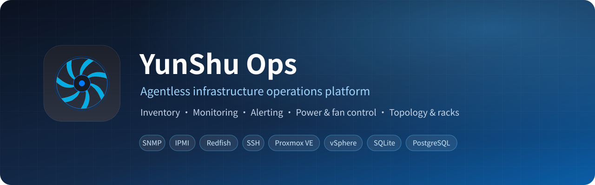
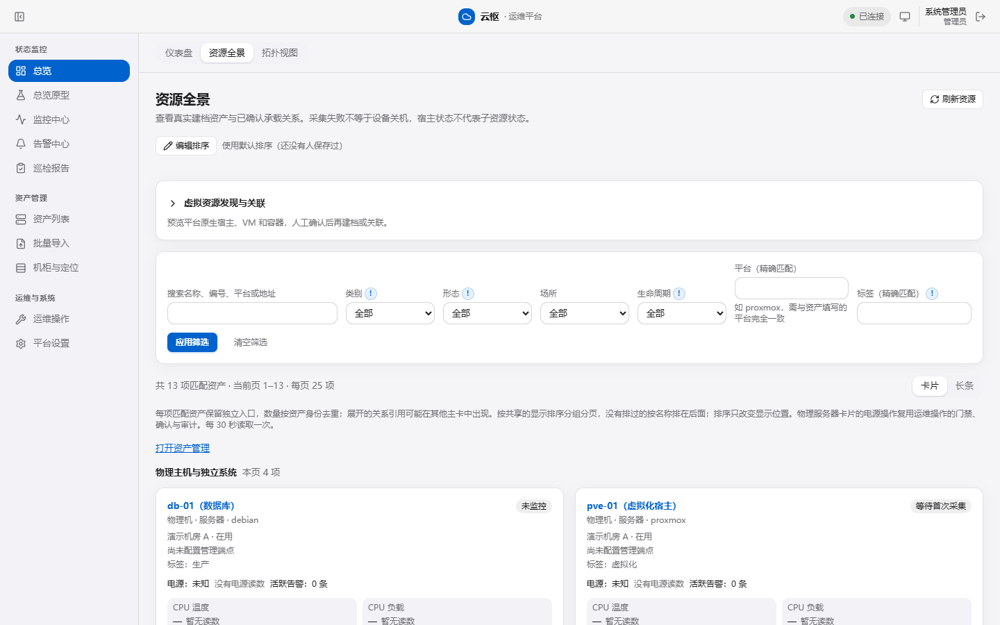
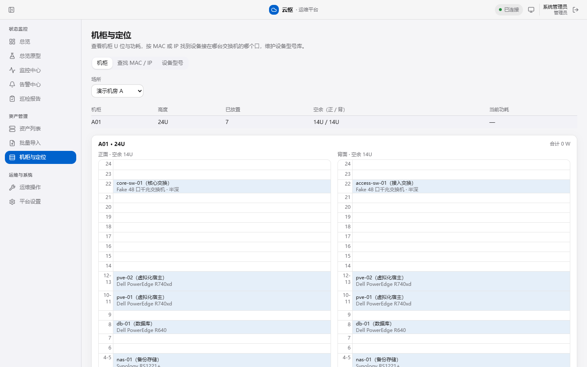
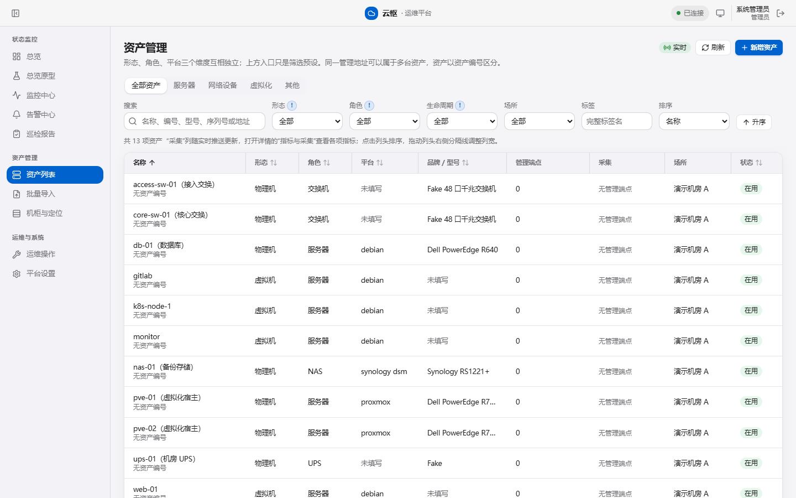
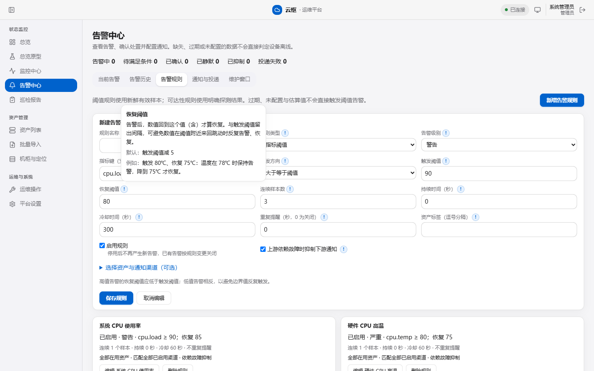
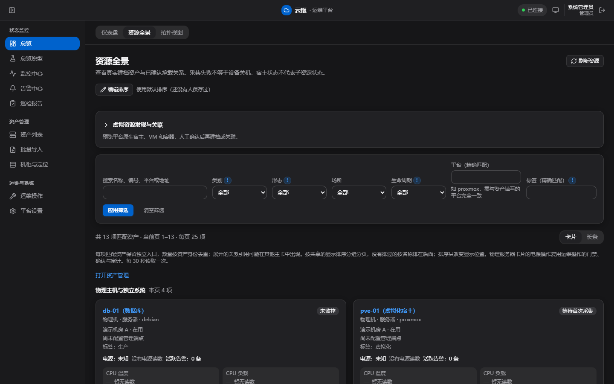

<div align="center">



<p>
  
  
  
  
  
  
</p>

**Agentless infrastructure operations for home labs, small server rooms and SMB data centers**

Servers · switches · virtualization · UPS · NAS — one inventory, unified collection, sensible alerts, guarded operations

[**📖 Documentation (Chinese)**](https://kongbai9420.github.io/YunShu/) · [**Quick start**](#-quick-start) · [**Download**](https://github.com/kongbai9420/YunShu/releases) · [**Screenshots**](#-screenshots) · [**💬 QQ group**](https://qm.qq.com/q/C2VkzggZge) · [中文](README.md)

</div>

> [!NOTE]
> The current version is 4.4.0-beta.1 (beta) and includes all 4.1–4.4 features. Device integrations have only been tested against simulated devices. **Real-hardware validation is still in progress**; please try it in a test environment first.

## ✨ Highlights

<table>
<tr>
<td width="33%" valign="top">

### 🧭 Agentless collection
SNMP v2c / v3, SSH, IPMI, Redfish, Proxmox VE, VMware ESXi / vCenter. Dell iDRAC is polled **over SNMP first**, so the BMC log stays free of login noise.

</td>
<td width="33%" valign="top">

### 🔔 Alerts that stay quiet
Threshold and reachability rules, upstream suppression, maintenance windows; e-mail and chat-bot webhooks; daily inspection reports; command inspections (read-only commands run over SSH on servers, Proxmox VE and Huawei / H3C switches from templates, once or daily / weekly / monthly, with alerts on critical findings).

</td>
<td width="33%" valign="top">

### 🛡️ Guarded operations
IPMI power; fan curves with an 82 °C safety fuse, with fan commands picked by the model and BMC firmware read from the device (built in for Dell, Supermicro, Huawei / xFusion and HPE; admins can add their own); gates, typed confirmations and audit — never retried automatically after a timeout.

</td>
</tr>
<tr>
<td valign="top">

### 🗄️ Racks & locating
Rack elevations with power draw, a device-type library, and MAC / IP lookup down to the switch port.

</td>
<td valign="top">

### 🖥️ Virtualization aware
VM power through PVE / vSphere; host shutdown can stop its guests first and wait for them (off by default).

</td>
<td valign="top">

### 🚀 Three deployment tiers
Lightweight (SQLite, single container or Windows portable build) → standard (PostgreSQL) → enterprise (multiple workers).

</td>
</tr>
<tr>
<td valign="top">

### 🧯 Vulnerability intel
Subscribe to NVD, CISA KEV, OSV, Chinese vulnerability databases and vendor advisories; impact is judged from your local firmware and package versions, and one CVE from many sources becomes one notification listing every source.

</td>
<td valign="top">

### 🤖 AI assistant (optional)
Bring your own model — major international and Chinese providers or a local model: vulnerability impact analysis, alert explanation, inspection summaries, a Q&A assistant, and a read-only MCP endpoint for external AI tools.

</td>
<td valign="top">

### 🔐 AI boundaries enforced in code
Off by default; data de-identified before sending; AI is read-only and cannot act (read-only transactions plus an architecture test); every call is traceable.

</td>
</tr>
</table>

## 🖼️ Screenshots

<div align="center">

<sub>Resource overview: physical hosts, hypervisors and the VMs they run</sub>
</div>

<br>

<table>
<tr>
<td width="50%" align="center"><br><sub>Front and rear rack elevations</sub></td>
<td width="50%" align="center"><br><sub>Asset inventory with filters</sub></td>
</tr>
<tr>
<td align="center"><br><sub>Every setting is explained; “!” pills open the details</sub></td>
<td align="center"><br><sub>Dark mode</sub></td>
</tr>
</table>

<sub>The UI is in Chinese. Screenshots use fake demo data.</sub>

## 📦 Features

| Area | What you get |
| --- | --- |
| **Inventory** | Assets (form / role / platform are independent), management endpoints with encrypted credentials, bulk import, subnet discovery, asset relations; deleted assets go to a recycle bin and can be restored within the retention period |
| **Collection** | SNMP, SSH, IPMI, Redfish, PVE API, ESXi / vCenter, TCP reachability; UPS-MIB, Synology and MikroTik adapters; server BMCs are probed per protocol and each data item comes from one primary source, with fallbacks only on failure |
| **Monitoring** | Metric history with raw / minute / hour retention, live updates, dashboards, resource overview, worker status |
| **Alerting** | Threshold and reachability rules, upstream suppression, maintenance windows, e-mail and chat-bot webhooks, daily inspection reports; a "server alarms" view of each BMC hardware event-log entry (Redfish, IPMI fallback; optional SNMP Trap and Redfish event push), with direct notification of critical events and handling notes |
| **Inspection** | Built-in read-only templates for Linux, Proxmox VE, Huawei and H3C; admins can copy and customize them (dangerous commands are refused on save); jobs run once (now or at a set time) or daily / weekly / monthly; per-item verdicts with comparison to the previous output; alerts on critical findings; daily inspection reports |
| **Operations** | IPMI power; fan curves with a safety fuse (IPMI / Redfish fan commands matched by model and BMC firmware, custom commands supported); VM power; host shutdown that stops its guests first; one-click SNMP enablement on server BMCs over Redfish (Dell iDRAC, HPE iLO and others; off by default) |
| **Topology & racks** | LLDP-discovered candidate links with manual confirmation and multiple layouts; rack elevations, device-type library, MAC / IP port lookup |
| **Access control** | Admin / operator / viewer roles plus per-site and per-asset scopes; optional OIDC SSO; read-only API tokens and Prometheus `/metrics` |
| **Vulnerability intel** | CVE.org records (updated about every 7 minutes), NVD, CISA KEV, OSV, EPSS, GitHub advisories, Chaitin / OSCS / Qianxin / ThreatBook, vendor RSS and watchvuln push, each enabled by you; online sync off by default with an offline bundle; local impact from version matching; fixed versions, source fix advice and workarounds, patch and vendor advisory links in one place; triage with review dates; instant alerts as soon as new data arrives (an early warning on a subscription hit, then a confirmation) plus a daily digest |
| **AI (optional)** | OpenAI-compatible, Claude, Gemini and Azure protocols with 20+ presets including Ollama and other local models; connection self-check; vulnerability impact analysis, alert explanation, inspection summaries, the "问云枢" assistant and a read-only MCP endpoint |
| **Deployment** | Lightweight / standard (PostgreSQL 16 / 17) / enterprise; first-run setup wizard; pg_dump backups |

## 🚀 Quick start

The image supports amd64 / arm64 and runs on Synology, fnOS, QNAP, Unraid and any Linux host.

**Option 1: a single command**

```bash
docker run -d --name yunshu --restart unless-stopped \
  -p 8080:8080 -v yunshu-data:/data -v yunshu-keys:/etc/yunshu \
  -e YUNSHU_EMBEDDED_WORKER=1 -e YUNSHU_SETUP_WIZARD=0 \
  ghcr.io/kongbai9420/yunshu:4.4.0-beta.1
```

**Option 2: Docker Compose (recommended, NAS-friendly)**

Save as `docker-compose.yml` and run `docker compose up -d`. In Synology Container Manager or fnOS, create a "Project / Compose" and paste this in:

```yaml
services:
  yunshu:
    image: ghcr.io/kongbai9420/yunshu:4.4.0-beta.1
    container_name: yunshu
    command: ["api"]
    ports:
      - "8080:8080"
    volumes:
      - yunshu-data:/data
      - yunshu-keys:/etc/yunshu
    environment:
      YUNSHU_EMBEDDED_WORKER: "1"
      YUNSHU_SETUP_WIZARD: "0"
      TZ: Asia/Shanghai
    restart: unless-stopped

volumes:
  yunshu-data:
  yunshu-keys:
```

Open `http://<host or NAS IP>:8080`, sign in with `admin` / `admin123` and change the password when prompted.

> [!TIP]
> **[Documentation site](https://kongbai9420.github.io/YunShu/)** (Chinese): installation, configuration, devices, alerts, operations, backup and upgrades.
>
> **[Full Docker deployment guide](deploy/README.en.md)**: PostgreSQL standard-tier YAML, step-by-step Synology / fnOS instructions, keeping data in shared folders, master-key backup, upgrades and troubleshooting.

**Option 3: Linux package (no Docker)**

Download `yunshu-<version>-linux-<amd64|arm64>.tar.gz` from [Releases](https://github.com/kongbai9420/YunShu/releases). It bundles its own runtime and installs as a systemd service on Debian, Ubuntu, Rocky / Alma (8, 9) and openEuler; Kylin V10 is covered through the glibc 2.28 openEuler 20.03 / EL8 bases but not yet tested on Kylin itself. See the [Linux install guide](deploy/linux/README.en.md).

**Option 4: Windows**

- **Server edition**: install `Yunshu-<version>-windows-amd64.msi`. It runs as a Windows service that starts with the machine and is reachable from other computers; SQLite by default, external PostgreSQL optional. See the [Windows install guide](deploy/windows/README.en.md).
- **Single-user desktop**: download the portable ZIP, unzip and double-click; local use only.

Verify downloads with the [verification guide](deploy/VERIFY.en.md).

## 💬 Community

- **QQ beta-testing group: 317151818** ([join via link](https://qm.qq.com/q/C2VkzggZge), Chinese): questions, device compatibility reports and feature ideas.
- Bugs and requests are also welcome in [GitHub Issues](https://github.com/kongbai9420/YunShu/issues).

## 🛠️ Contributing

| File | Contents |
| --- | --- |
| [backend/README.md](backend/README.md) | Backend layout, APIs, migrations, test commands (Chinese) |
| [frontend/README.md](frontend/README.md) | Frontend layout, local preview, browser tests (Chinese) |

## 🧱 Tech stack

<p>
  
  
  
  
  
  
  
</p>

Backend: FastAPI + SQLAlchemy + Alembic. Frontend: React + TypeScript + Vite. Worker and API share one code base; database is SQLite or PostgreSQL 16 / 17.

## 🔒 Security notes

> [!WARNING]
> The platform sends power and fan commands to servers. Control must be explicitly handed over by an administrator, high-risk actions require a typed confirmation, and timed-out operations are never retried automatically.
> The built-in fan commands come from vendor documentation and community sources and **have not yet been verified on real hardware**; try them on a non-production server first and make sure restoring automatic fan control works.

- Device credentials are encrypted with a master key that is stored separately from the data — **back up the master key on its own**.
- Put the platform behind an HTTPS reverse proxy for remote access and set `YUNSHU_SECURE_COOKIES=1`.

## 📄 License

[MIT](LICENSE). Third-party licenses are listed in the notices shipped with the image and the portable build.
