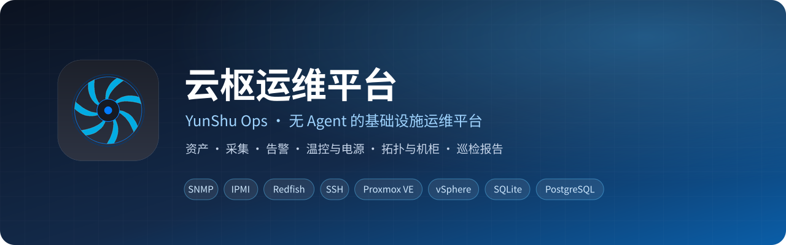

<div align="center">



<p>
  
  
  
  
  
  
</p>

**面向家庭实验室、小机房与中小企业的无 Agent 基础设施运维平台**

服务器 · 交换机 · 虚拟化 · UPS · NAS —— 一处建档、统一采集、按需告警、受控操作

[**📖 使用文档**](https://kongbai9420.github.io/YunShu/) · [**快速开始**](#-快速开始) · [**下载**](https://github.com/kongbai9420/YunShu/releases) · [**界面预览**](#-界面预览) · [**💬 QQ 交流群**](https://qm.qq.com/q/C2VkzggZge) · [English](README.en.md)

</div>

> [!NOTE]
> 当前版本 4.4.0-beta.2（测试版），包含 4.1–4.4 的全部功能。所有设备适配目前只用模拟设备测试过，**真实设备验证仍在进行**，请先在测试环境试用。

## ✨ 亮点

<table>
<tr>
<td width="33%" valign="top">

### 🧭 无 Agent 采集
SNMP v2c / v3、SSH、IPMI、Redfish、Proxmox VE、VMware ESXi / vCenter。Dell iDRAC **以 SNMP 为主**，几乎不留 BMC 登录记录。

</td>
<td width="33%" valign="top">

### 🔔 不吵人的告警
阈值与可达性规则、上游故障抑制、维护窗口；邮件和多种机器人通知；每日巡检报告；命令巡检（按模板经 SSH 在服务器、PVE、华为 / H3C 交换机上执行只读命令，单次或每天 / 每周 / 每月定时，严重异常生成告警）。

</td>
<td width="33%" valign="top">

### 🛡️ 受控的操作
IPMI 开关机；风扇温控曲线、情景方案与 82 ℃ 熔断，按设备读出的型号与 BMC 固件自动匹配风扇命令（内置 Dell、超微、华为 / 超聚变、HPE，其他厂商可由管理员自定义）；门禁、确认语、审计，超时不自动重试。

</td>
</tr>
<tr>
<td valign="top">

### 🗄️ 机柜与定位
机柜 U 位与功耗、设备型号库，按 MAC / IP 找到设备接在哪台交换机的哪个口。

</td>
<td valign="top">

### 🖥️ 虚拟化联动
PVE / vSphere 虚拟机开关机；关宿主前先关其上虚拟机并等待完成（默认关闭）。

</td>
<td valign="top">

### 🚀 三档部署
轻量版（SQLite，单容器或 Windows 免安装包）→ 标准版（PostgreSQL）→ 企业版（多 Worker）。

</td>
</tr>
<tr>
<td valign="top">

### 🧯 漏洞情报
订阅 NVD、CISA KEV、OSV、国内漏洞库与厂商公告；按本地固件与软件包版本判断影响范围，同一漏洞多来源合并通知并标注来源。

</td>
<td valign="top">

### 🤖 AI 助手（可选）
自行接入国内外主流大模型或本地模型：漏洞影响分析、告警解读、巡检摘要、问答助手，以及供外部 AI 工具使用的只读 MCP 接口。

</td>
<td valign="top">

### 🔐 AI 边界由代码保证
默认关闭；发送前脱敏；AI 只读、不能执行任何操作（只读事务 + 架构测试强制）；每次调用可追溯。

</td>
</tr>
</table>

## 🖼️ 界面预览

<div align="center">

<sub>资源全景：物理主机、虚拟化宿主与其上的虚拟机</sub>
</div>

<br>

<table>
<tr>
<td width="50%" align="center"><br><sub>机柜正反面 U 位</sub></td>
<td width="50%" align="center"><br><sub>资产台账与筛选</sub></td>
</tr>
<tr>
<td align="center"><br><sub>每个设置项都有说明，「!」胶囊看详细解释</sub></td>
<td align="center"><br><sub>深色模式</sub></td>
</tr>
</table>

<sub>截图使用伪造的演示数据。</sub>

## 📦 功能一览

| 方面 | 内容 |
| --- | --- |
| **资产** | 资产台账（形态 / 角色 / 平台相互独立）、管理端点与加密凭据、批量导入、网段发现、资产关系；删除先进回收站，保留期内可恢复 |
| **采集** | SNMP、SSH、IPMI、Redfish、PVE API、ESXi / vCenter、TCP 可达性；UPS-MIB、Synology、MikroTik 适配；服务器 BMC 自动探测各协议能力，每项数据只由一个主来源提供、失败才兜底 |
| **监控** | 指标历史（原始 / 分钟 / 小时三级保留）、实时推送、仪表盘、资源全景、Worker 状态 |
| **告警** | 阈值与可达性规则、上游抑制、维护窗口、邮件与机器人通知、每日巡检报告；“服务器告警”板块逐条查看 BMC 硬件事件日志（Redfish 读取，IPMI 兜底；可选 SNMP Trap 与 Redfish 事件推送），严重事件直接通知并标记处理 |
| **巡检** | 内置 Linux、Proxmox VE、华为、H3C 巡检模板（只读），管理员可复制后自定义（保存时拦截危险命令）；巡检任务单次（立即或指定时间）/ 每天 / 每周 / 每月；执行记录逐项判定并可对比上一次输出；严重异常生成告警；每日巡检报告 |
| **运维操作** | IPMI 电源；风扇温控曲线、情景方案与熔断（按型号与 BMC 固件匹配 IPMI / Redfish 风扇命令，支持自定义）；虚拟机电源；宿主关机前先关虚拟机；经 Redfish 一键开启服务器 BMC 的 SNMP（Dell iDRAC、HPE iLO 等，默认关闭） |
| **拓扑与机柜** | LLDP 自动发现候选链路并人工确认、多视图布局；机柜 U 位、设备型号库、MAC / IP 端口定位 |
| **权限** | 管理员 / 运维 / 只读，按场所与资产划分范围；可选 OIDC 单点登录；只读 API 令牌与 Prometheus `/metrics` |
| **漏洞情报** | CVE 官方记录（约 7 分钟更新）、NVD、CISA KEV、OSV、EPSS、GitHub 安全公告、长亭 / OSCS / 奇安信 / 微步、厂商 RSS、watchvuln 推送，逐个由你启用；外网同步默认关闭，可导入离线包；按版本比对出本地影响；汇总各来源的修复版本、修复建议与临时缓解原文和补丁 / 厂商公告链接；处置记录与复查；即时通知（拉到新数据即发，订阅命中先发预警、确认后再发）+ 每日汇总 |
| **AI（可选）** | OpenAI 兼容、Claude、Gemini、Azure 四种协议，预置 20 多家国内外厂商与 Ollama 等本地模型；连接自检；漏洞影响分析、告警解读、巡检摘要、问答助手“问云枢”、只读 MCP 接口 |
| **部署** | 轻量版 / 标准版（PostgreSQL 16 / 17）/ 企业版；首次启动向导；pg_dump 备份 |

## 🚀 快速开始

镜像支持 amd64 / arm64，群晖、飞牛 fnOS、威联通、Unraid 和普通 Linux 服务器都能直接部署。

**方式一：一条命令**

```bash
docker run -d --name yunshu --restart unless-stopped \
  -p 8080:8080 -v yunshu-data:/data -v yunshu-keys:/etc/yunshu \
  -e YUNSHU_EMBEDDED_WORKER=1 -e YUNSHU_SETUP_WIZARD=0 \
  ghcr.io/kongbai9420/yunshu:4.4.0-beta.2
```

**方式二：Docker Compose（推荐，也适合 NAS）**

保存为 `docker-compose.yml` 后执行 `docker compose up -d`；在群晖 Container Manager 或飞牛 fnOS 里，新建“项目 / Compose”后直接粘贴这段即可：

```yaml
services:
  yunshu:
    image: ghcr.io/kongbai9420/yunshu:4.4.0-beta.2
    container_name: yunshu
    command: ["api"]
    ports:
      - "8080:8080"
    volumes:
      - yunshu-data:/data
      - yunshu-keys:/etc/yunshu
    environment:
      YUNSHU_EMBEDDED_WORKER: "1"
      YUNSHU_SETUP_WIZARD: "0"
      TZ: Asia/Shanghai
    restart: unless-stopped

volumes:
  yunshu-data:
  yunshu-keys:
```

浏览器打开 `http://<主机或 NAS IP>:8080`，用 `admin` / `admin123` 登录后按提示修改密码。

> [!TIP]
> **[使用文档网站](https://kongbai9420.github.io/YunShu/)**：安装、配置、设备接入、告警、运维操作、备份升级的完整说明。
>
> **[完整 Docker 部署指南](deploy/README.md)**：PostgreSQL 标准版 YAML、群晖 / 飞牛图形界面逐步说明、数据放共享文件夹、主密钥备份、升级与常见问题。

**方式三：Linux 安装包（不用 Docker）**

在 [Releases](https://github.com/kongbai9420/YunShu/releases) 下载 `yunshu-<版本>-linux-<amd64|arm64>.tar.gz`，自带运行环境，装成 systemd 服务。支持 Debian、Ubuntu、Rocky / Alma（8、9）、openEuler；麒麟 V10 用同样基于 glibc 2.28 的 openEuler 20.03 / EL8 环境验证，尚未在麒麟本身上测试。步骤见 [Linux 安装说明](deploy/linux/README.md)。

**方式四：Windows**

- **服务器版**：下载 `Yunshu-<版本>-windows-amd64.msi` 安装，作为 Windows 服务开机自启，局域网内其他电脑可以访问；默认 SQLite，也可以连外部 PostgreSQL。见 [Windows 安装说明](deploy/windows/README.md)。
- **单人桌面版**：下载免安装 ZIP，解压后双击运行，只在本机使用。

下载的文件可以按 [校验说明](deploy/VERIFY.md) 核对签名与校验值。

## 💬 交流与反馈

- **QQ 内测群：317151818**（[点击链接加入群聊【云枢-服务器集群管理】](https://qm.qq.com/q/C2VkzggZge)）：试用问题、设备适配反馈、功能建议都可以在群里交流。
- 发现问题或有需求，也欢迎在 [GitHub Issues](https://github.com/kongbai9420/YunShu/issues) 提交。

## 🛠️ 参与开发

| 文件 | 内容 |
| --- | --- |
| [backend/README.md](backend/README.md) | 后端结构、接口、迁移、测试命令 |
| [frontend/README.md](frontend/README.md) | 前端结构、本地预览、浏览器测试 |

## 🧱 技术栈

<p>
  
  
  
  
  
  
  
</p>

后端 FastAPI + SQLAlchemy + Alembic，前端 React + TypeScript + Vite；Worker 与 API 同一代码库；数据库 SQLite 或 PostgreSQL 16 / 17。

## 🔒 安全提示

> [!WARNING]
> 平台会向服务器发送电源与风扇命令。控制功能需要管理员显式切换控制归属，高风险操作需输入确认语，超时不会自动重试。
> 内置的风扇命令整理自厂商文档与社区资料，**尚未在实机上验证**，请先在非生产服务器上试用，确认能恢复原厂温控。

- 设备凭据用主密钥加密保存，主密钥与数据分开存放，**请单独备份主密钥**。
- 对外访问请放在 HTTPS 反向代理之后，并设置 `YUNSHU_SECURE_COOKIES=1`。

## 📄 许可证

[MIT](LICENSE)。第三方组件的许可证见镜像与免安装包内附带的说明。
