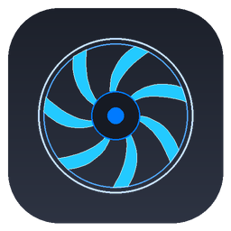

# 云枢运维平台 <small>4.4.0-beta.1</small>

> 面向家庭实验室、小机房与中小企业的无 Agent 基础设施运维平台

SNMPIPMIRedfishSSHProxmox VEvSphereLLDP

- 资产台账 · 指标采集 · 告警、巡检与漏洞情报
- 受控的电源与风扇操作 · 虚拟机联动
- Docker / NAS、Linux 安装包、Windows 服务版

测试版：设备适配目前只用模拟设备验证过，请先在测试环境试用。

[开始阅读](/wiki/README.md)
[快速开始](/wiki/quick-start.md)
[下载](https://github.com/kongbai9420/YunShu/releases)
[GitHub](https://github.com/kongbai9420/YunShu)
